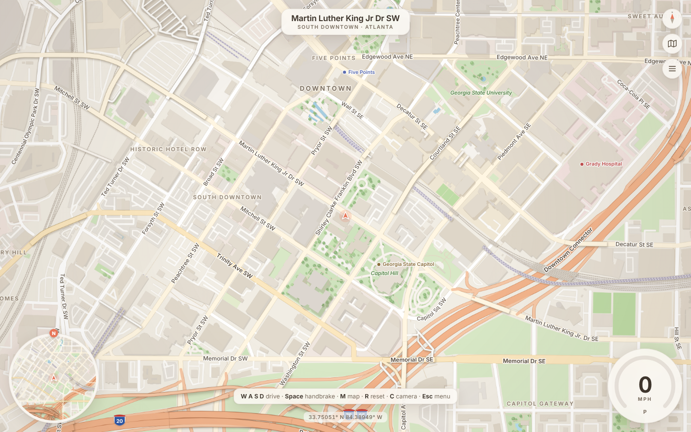
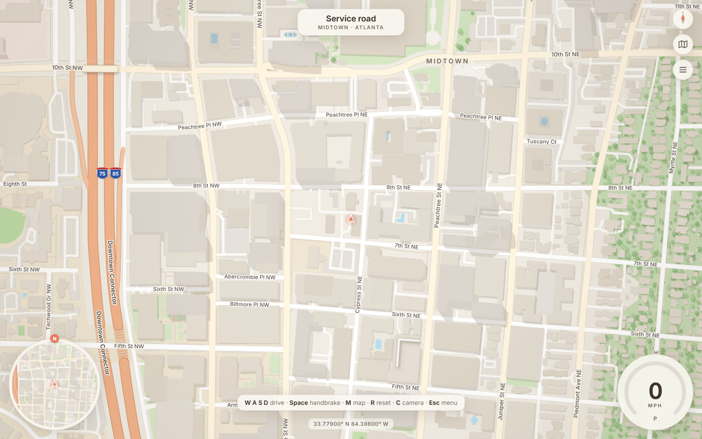
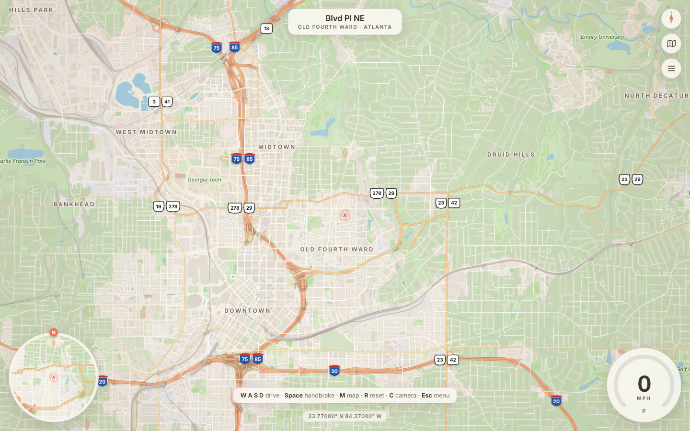
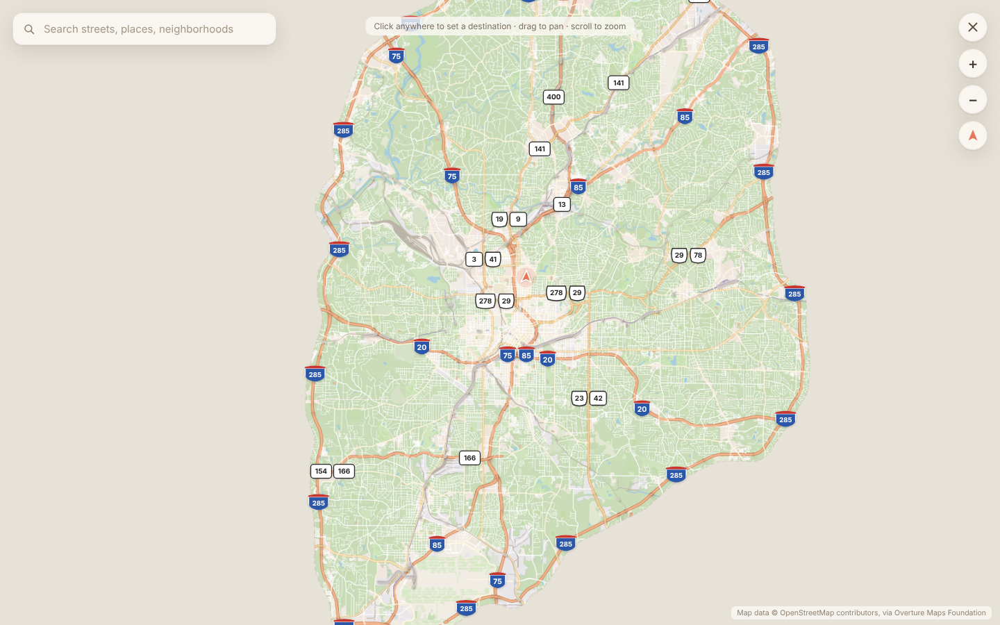
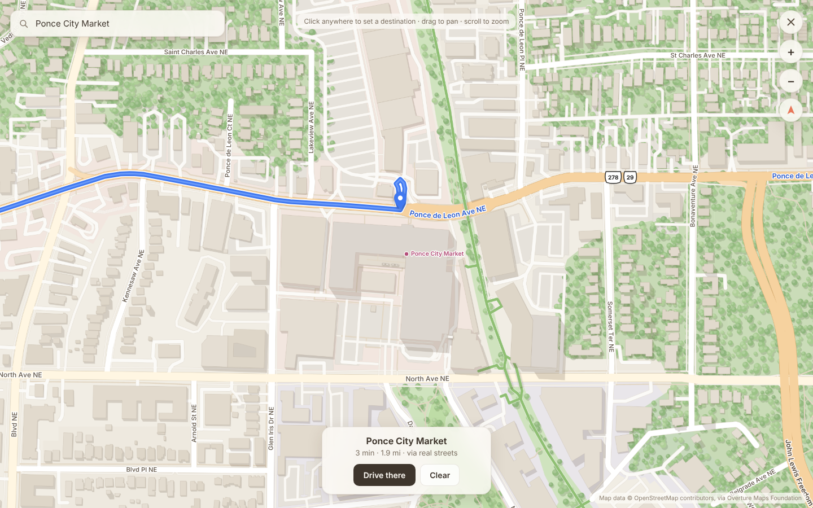
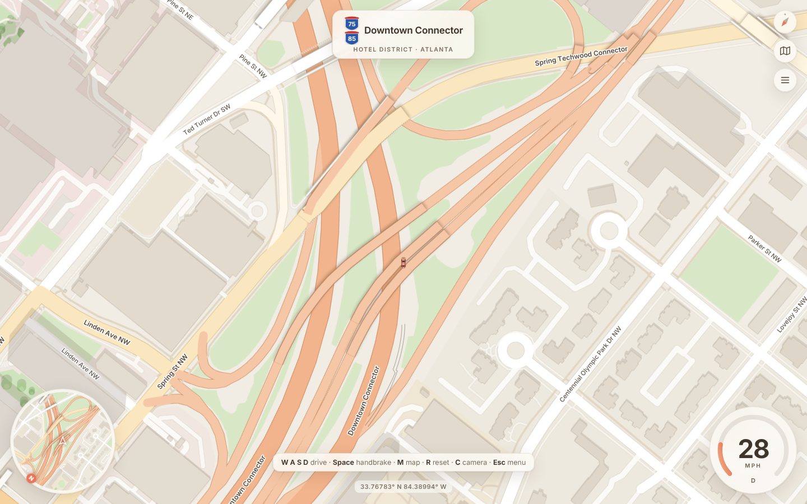

# Atlanta ITP — a top-down driving game on the real streets of Atlanta

Drive a little car through every mapped street inside I-285: down Peachtree, onto the Downtown Connector, out to Decatur, up GA-400 to Buckhead. The whole world is built from real OpenStreetMap geometry, including streets, ramps, bridges, one-ways, buildings, parks, lakes, and rail. There are no mocked or fictional streets.



| | |
|---|---|
|  Midtown, close-up |  Midtown → Old Fourth Ward → Decatur |
|  Full map, clipped to I-285 |  Search + route to Ponce City Market |
|  Downtown Connector, car-up camera | |

## Play

**[▶ Play in the browser](https://claude.ai/artifact/Pq8GizzPzzYPZMXqnhW1MP)**: wait for Midtown to load, press **Play**, then drive with W A S D. The link is private until it's shared from the page's Share menu.

## Quick start

```bash
npm install
npm run dev        # http://localhost:5173
```

The processed world data is committed in `public/world/` (about 49 MB), so the game runs immediately. To rebuild it from source data:

```bash
pip install pyarrow shapely numpy pyproj
npm run data:fetch   # downloads the Atlanta subset of the OSM-derived Overture release (≈130 MB, cached in data/raw/)
npm run data:build   # projects, clips to I-285, chunks, builds labels/search/routing → public/world/
```

`npm run build` produces a static site in `dist/` that can be hosted anywhere (no server code, no API keys). `npm run build:artifact` also writes `dist-artifact/`, a version for hosts that only serve standard web file types. Its binary data files get a `.wasm` suffix, and the manifest tells the game to request them that way.

## Controls

| Key | Action |
| --- | --- |
| W / ↑ | Accelerate |
| S / ↓ | Brake, then reverse |
| A D / ← → | Steer |
| Space | Handbrake (drift) |
| Mouse wheel, + / − | Zoom |
| R | Reset car onto the nearest road, facing legal traffic direction |
| M | Full-screen map (search, destinations, routing) |
| C | Toggle north-up / car-up camera |
| V | Next vehicle |
| T | Toggle map style (cartographic / realistic) |
| F3 or ` | Debug overlay (fps, tile stats, road under car) |
| Esc | Pause and settings |

A gamepad also works: left stick to steer, RT/LT for throttle/brake, A/B for the handbrake.

## What's in it

**World.** The world covers the inside of I-285. The clip polygon is computed from the real I-285 mainline carriageways: for every angular bin around the city it takes the outermost interstate vertex, plus a 350 m margin so the Perimeter and its interchanges are included. The resulting area is 647 km². Inside it there are:

- 192k OSM road and rail segments and 256k building footprints.
- Parks, golf courses, cemeteries, sports pitches, running tracks, parking lots, lakes, and creeks like Peachtree Creek.
- Tree canopy from ESA WorldCover.

**Map rendering.** The renderer is a custom slippy-map engine:

- A pool of Web Workers rasterises 512 px tiles with Canvas 2D on OffscreenCanvas. That gives anti-aliased roads with round joins, casings drawn under fills so intersections merge cleanly, and real layered bridges with drop shadows (OSM `layer`/`bridge`). Tunnels are drawn faded and dashed.
- Building shadows are extruded from footprint heights.
- Within real wooded and park areas, the tree canopy is drawn as procedural trees.
- There are one-way chevrons, BeltLine trails highlighted in green, and a fogged area outside the Perimeter.
- The map data comes in three LODs: 1 km full-detail chunks, 4 km simplified chunks, and 16 km overview chunks. Tiles are cached in an LRU and requested by priority from the view centre outward. Coarser tiles fill in while sharper ones render, so there are no loading screens while driving.
- Labels are laid out live every frame, so they stay crisp and upright in car-up mode. Street names curve along the road, with collision avoidance and priority by road class. There are also neighborhood names, landmark pins, park and water names, and Interstate, US, and GA route shields.

**Vehicles.** Six vehicles share the physics model with different parameters. You pick one on the title screen or in the pause menu, or press V to cycle in game.

| Vehicle | Character |
| --- | --- |
| Sedan | balanced |
| City Hatch | slow, nimble, very forgiving |
| Sports Coupe | fastest, grippy but twitchy at the limit |
| Muscle Car | huge power, loose rear end, easy to drift or spin |
| SUV | heavy, understeers, very stable |
| Box Truck | slow and wide, almost impossible to spin |

They differ in mass, front and rear grip, stability-assist strength, steering speed, and top-speed multiplier. Each has its own sprite.

**Map styles.** *Cartographic* is the default map look. *Realistic* (T) is a simplified aerial look, drawn entirely from the same vector data with no satellite imagery:

- asphalt roads with concrete curbs, white lane dashes, yellow center lines, and white crosswalks;
- textured lawns and dense tree canopy;
- shingle roofs on houses, flat light roofs on larger buildings, with sun-side bevels and stronger shadows;
- deep-blue water and gravel rail beds.

Labels switch to white with dark halos.

**Projection.** A Transverse Mercator projection is centred on Atlanta (WGS84). It is conformal, with under 0.001 % scale error inside I-285, so road angles and shapes are not distorted. The HUD inverts it to show live latitude and longitude.

**Driving.**

- The physics is arcade-style: a kinematic-bicycle yaw model with grip-limited lateral velocity, speed-dependent steering lock, momentum, braking, reverse, and handbrake oversteer for drifting. It also has skid marks, tire smoke, brake lights, and wheels that turn.
- Each road class has a soft top speed. Freeways allow about 130 mph, arterials about 70, and side streets about 47. Off-road and grass are slower with less grip.
- Buildings are solid (circle-vs-polygon collision). Buildings that span a road (passages, canopies) are passable.
- The camera follows smoothly, with velocity look-ahead, zoom-out at speed, impact shake, and optional car-up rotation.
- "Game speed" (default 1.5×) compresses time so crossing the city doesn't take real-world minutes. The speedometer always shows true speed through the real-scale world. The car is drawn at 1.8× scale by default ("Miniature"). Both can be changed in the pause menu.

**HUD.**

- Speed gauge in MPH.
- Current street name, with route shields on highways.
- Neighborhood and city.
- Rotating compass.
- Circular minimap.
- Coordinates.
- Turn-by-turn card when navigating.
- Pause and settings menu.

**Navigation.**

- Press M for an interactive map of all of ITP. You can pan, zoom, pinch, and search across about 9.3k street names, 14k real places, 42 landmarks, and about 200 neighborhoods.
- Click anywhere or pick a search result to set a destination. A* runs over a 117k-node graph built from OSM connectivity and respects one-way restrictions.
- While driving, you get the highlighted route, turn-by-turn instructions (turns, exits, merges), distance, ETA, automatic rerouting when you go off-route, and arrival detection.

## Architecture

```
tools/fetch_overture.py     bbox-filtered download of the OSM-derived Overture GeoParquet (S3, no key)
tools/build_world.py        projection, I-285 clip, LOD chunking (binary), labels, search, routing graph
public/world/               generated data (manifest.json, L0/L1/L2/*.pack chunk bundles, labels/, routing.bin, search.json)
tools/make_artifact.py      packages dist/ as a single hostable page (npm run build:artifact)
src/world/                  binary container reader, chunk decoder, projection & geometry helpers, feature codes
src/render/tileDraw.ts      the cartography (runs in workers)
src/render/tileWorker.ts    worker: chunk cache + tile rasteriser
src/render/tileCache.ts     main thread: worker pool, priority queue, LRU, fallback compositing
src/render/labels.ts        live label placement, shields
src/render/style.ts         the palette and road styles
src/render/carDraw.ts       car sprite, skid marks, smoke, route line, pins
src/game/                   game loop, car physics, camera, input, world queries (road under car, surface, collisions)
src/nav/                    routing graph + A*, maneuver generation, route following, search
src/ui/                     HUD, full-screen map, styles
```

### Extending it

The code is structured so later features plug into existing pieces:

- `RoadGraph` already holds the full directed drivable network with geometry, which is what AI traffic, missions, and deliveries need.
- `routing.bin` and the chunk `lines` keep road class, one-way flags, and level.
- Traffic signals (2.5k) and stop signs (1.5k) are in the downloaded Overture `infrastructure` layer, ready to be exported for traffic lights.
- `Handling` in `car.ts` parameterises the vehicle, so different cars are just different parameter sets.
- `Settings` and the palette in `style.ts` are where a day/night or weather theme would hook in.
- `WorldQuery` gives any agent road, surface, and collision queries.

## Data sources and honest limitations

- **Why Overture instead of Overpass.** The environment this was built in blocks the OpenStreetMap servers (Overpass, Geofabrik, planet.osm). The [Overture Maps](https://overturemaps.org) release on public S3 was reachable. Its transportation, land-use, water, and divisions layers are built from OpenStreetMap: every road segment keeps its OSM way id (e.g. `w9277798`), and topology is preserved through shared connectors. This is OSM geometry redistributed under ODbL; please keep the "© OpenStreetMap contributors" attribution.
  - Buildings: 94.5 % OSM, 5.4 % Microsoft ML footprints, 0.07 % Esri Community Maps (Overture's conflation).
  - Tree canopy: ESA WorldCover.
  - Searchable places: Overture Places (Meta, Microsoft, Foursquare and others), not OSM.
- **Neighborhoods.** Neighborhood points and polygons come from OSM via Overture divisions, which is incomplete for Atlanta. 17 well-known neighborhoods that were missing (Downtown, Grant Park, West Midtown, Morningside, Poncey-Highland, East Atlanta and others) were given hand-placed approximate label anchors in `CURATED_HOODS` in `build_world.py`. They are marked `src: "curated"` in the data. No map geometry is curated.
- **Road widths** come from road class, not lane counts (Overture doesn't carry OSM `lanes`). Most roads are realistic. Wide stretches like the 14-lane Connector are drawn narrower than reality.
- **Bridges and tunnels** come from OSM `bridge`/`tunnel`/`layer` tags and are drawn layered. The car itself is always drawn on top, including when it drives under an overpass.
- **Routing** respects one-ways and connectivity. It does **not** yet apply turn restrictions (`prohibited_transitions`), time-based access, or traffic. Private driveways and parking aisles are excluded from routing.
- **Trees** inside parks and wooded areas are real *areas*, but individual tree positions are procedurally scattered within them.
- **Not included yet:** AI traffic, traffic lights and stop signs, pedestrians, multiple vehicles, day/night, weather, missions, multiplayer, saved routes.
- **Browser support.** The renderer needs OffscreenCanvas 2D in workers: current Chrome, Edge, Firefox, or Safari 16.4+.
